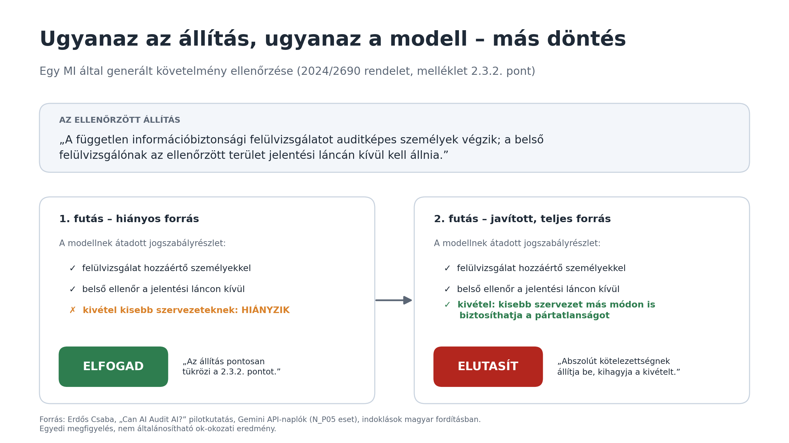

# Can AI Audit AI?

**Evaluating the reliability of LLM-based cybersecurity compliance assessment — a small pilot on Commission Implementing Regulation (EU) 2024/2690 (NIS2).**

Csaba Erdős · MSc student, Cybersecurity Engineering, Óbudai Egyetem (Óbuda University)
Presented at the IV. Alverad–Bánki International Conference on Cybersecurity and Research Development, 22 October 2026 (English section, online).

📄 [Slides (PDF)](docs/slides.pdf) · 🇭🇺 [Magyar leírás](README_HU.md)

---

## The question

If one AI model writes a compliance requirement and a second AI model says *"looks good"* — should that make us more confident?

This pilot looks at what an AI reviewer's verdict actually tells us when it checks statements about the Annex of Regulation (EU) 2024/2690: whether it catches deliberately distorted requirements, how its decisions depend on the evidence it is given, and how often it declines to decide.

## Two experiments, 160 logged model decisions

| Track | What was reviewed | Review conditions | Decisions |
|---|---|---|---|
| **A – Controlled** | 40 statements on 20 Annex points (20 faithful, 20 deliberately distorted), hidden provisional labels | Gemini without source · Gemini with analyst summary · DeepSeek without source | 120 |
| **B – AI-generated** | 8 control statements generated by GPT-5 mini | same-model review (fresh context) · Gemini without source · Gemini + summary · Gemini + legal excerpt · Gemini + corrected excerpt | 40 |

## Results

**Track A — agreement with provisional analyst labels** (single run, [`results/controlled_metrics.csv`](results/controlled_metrics.csv)):

| Condition | Agreement | Distorted claims accepted | Faithful claims rejected | Uncertain |
|---|---|---|---|---|
| Gemini, no source | 37/40 (92.5%) | 0/20 | 1/20 | 2 |
| Gemini, analyst summary | 40/40 (100%) | 0/20 | 0/20 | 0 |
| DeepSeek, no source | 36/40 (90%) | 0/20 | 1/20 | 3 |

> ⚠️ These are **agreement with provisional labels**, not legal accuracy. The labels and reference summaries were written by the author and have not yet been independently adjudicated; the best condition received a summary that already expressed the intended interpretation.

**Track B — decision distribution** ([`results/natural_decisions.csv`](results/natural_decisions.csv)): the same-model review returned `UNCERTAIN` in 8/8 cases; Gemini accepted 7/8 without source, 6/8 with a summary, 8/8 with the first excerpts, 7/8 after one excerpt was corrected. These are decision counts, not correctness scores.

### The key case: N_P05 (Annex 2.3.2)



The generated statement required internal reviewers to sit outside the reporting line of the area under review. The first excerpt given to Gemini omitted the provision's exception (entities too small to separate reporting lines may use alternative measures to ensure impartiality) — Gemini **accepted**. With the exception added, the same model **rejected** the same statement as presenting the separation as absolute. One observed, source-sensitive decision change; not a general causal estimate.

## Takeaway

An AI reviewer can reduce repetitive work and flag inconsistencies, but its verdict is only meaningful if we know **what it saw, what it missed, and why it decided**. Source completeness belongs in the audit trail; responsibility for legal interpretation stays with people.

## Limitations

Small, hand-built pilot · provisional, not independently validated labels · conditions not fully matched (model and evidence vary) · single runs · the corrected excerpt is a substantive input change, not a repeat · interpreting regulation ≠ evidence that an organisation complies.

## Reproduce

Python 3.10+; only the standard library is required (`matplotlib` optional for charts).

```bash
python study.py validate                     # check the dataset, no API calls
python study.py report                       # rebuild metrics from logged responses
python study.py run-controlled --limit 2     # dry run; add --execute to call APIs
```

API keys are read from `OPENAI_API_KEY`, `GEMINI_API_KEY`, `DEEPSEEK_API_KEY` environment variables. No call is made without `--execute`. Full Hungarian instructions: [README_HU.md](README_HU.md).

## Repository layout

```
study.py                     test runner (generate / run / report)
controlled_cases.csv|json    Track A dataset (40 claims)
anchor_reference.csv         Annex points, analyst summaries, validation status
natural_candidates.csv       Track B generated statements + source excerpts
AI_Audit_AI_Pilot_Dataset.xlsx  human-readable workbook
results/                     raw API responses (jsonl), decisions, metrics, figures
docs/                        slides, figure
```

## Legal sources

- Commission Implementing Regulation (EU) 2024/2690 — https://eur-lex.europa.eu/legal-content/EN/TXT/?uri=CELEX:32024R2690
- ENISA NIS2 Technical Implementation Guidance (non-binding) — https://www.enisa.europa.eu/publications/nis2-technical-implementation-guidance

Statements in this repository are research test material, not legal advice.

## Licence

Code: [MIT](LICENSE) · Data, results, slides and figures: [CC BY 4.0](LICENSE-DATA.md)

## Citation

> Erdős, Cs. (2026). *Can AI Audit AI? Evaluating the Reliability of LLM-Based Cybersecurity Compliance Assessment.* IV. Alverad–Bánki International Conference on Cybersecurity and Research Development, Budapest (online), 22 October 2026. https://github.com/Erdscsb/can-ai-audit-ai
